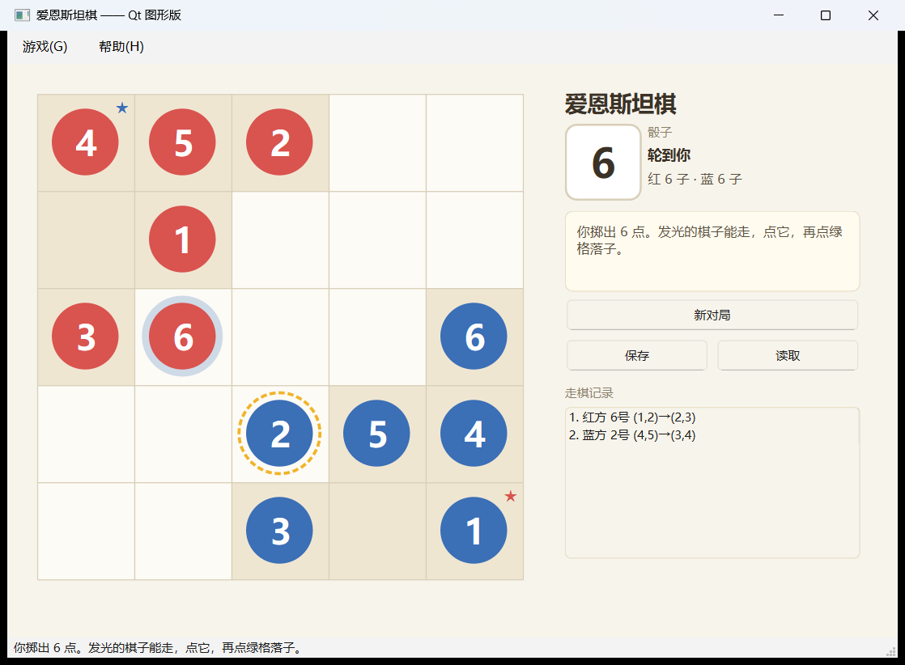

# 爱恩斯坦棋 · Qt 图形版

计算概论课程大作业：**爱恩斯坦棋（Einstein Würfelt Nicht）人机对弈**的 Qt 图形界面版本。
规则、AI、存档逻辑都集中在 `core` 里（零 Qt 依赖），界面用 Qt Widgets 重写。

> 仓库里只包含图形版；早期的控制台实现没有一起放进来。
> 存档格式以本目录为准，不追求和旧存档兼容。



---

## 一、目录结构

```
einstein_gui/
├─ core.h / core.cpp       ← 从 einstein.cpp 原样抽出的核心逻辑（无 Qt 代码）
│     · namespace rules    走法、吃子、胜负、布阵
│     · class Ai           期望极小极大搜索
│     · class Game         一局棋的状态 + 存档读写
│
├─ boardwidget.h / .cpp    ← 棋盘控件：只负责"把局面画出来"和"把点击变成坐标"
├─ mainwindow.h / .cpp     ← 主窗口：按钮、菜单、回合流程、存档对话框
├─ main.cpp                ← QApplication + 显示主窗口
└─ einstein_gui.pro        ← 工程文件
```

**分层的意义**：`core.cpp` 里没有一个 `#include <Q...>`，算法和界面彻底分开——
换界面不用动算法，改算法不用碰界面。

---

## 二、怎么编译

### 只想玩（不用 Qt Creator、不用编译器）

双击这个 exe 就行（Qt 的 DLL 已经拷在旁边了）：

```
D:\计概大作业\爱恩斯坦棋\einstein_gui.exe
```

桌面上也放了个叫「爱恩斯坦棋」的快捷方式。
这个文件夹是**绿色版**：整个 `爱恩斯坦棋` 目录拷到任何 Windows 电脑都能直接跑（31 MB），
存档会存在它旁边的 `saves\` 里。

命令行运行（还能复现某一盘）：

```bat
cd /d D:\计概大作业\爱恩斯坦棋
einstein_gui.exe              :: 正常开一局
einstein_gui.exe --seed 777   :: 复现同一盘（标题栏会显示种子）
```

### 想改代码：Qt Creator（推荐）

1. 打开 Qt Creator；
2. **文件 → 打开文件或项目**，选 `einstein_gui.pro`；
3. 勾选 `Qt 6.8.3 MinGW 13.1 64-bit`，点右下角 `Configure Project`；
4. 按 **Ctrl+R** 运行。

### 命令行

```bat
set PATH=D:\Qt\6.8.3\mingw_64\bin;D:\Qt\Tools\mingw1310_64\bin;%PATH%
mkdir build && cd build
qmake ..\einstein_gui.pro
mingw32-make -j8
release\einstein_gui.exe
```

`build\release\` 里已经用 `windeployqt` 拷好了 Qt 的 DLL，可以整个文件夹拷走双击运行。

---

## 三、怎么玩

| 操作 | 说明 |
|---|---|
| **开局** | 启动时自动弹出设置框：阵营 / 难度 / 布阵 / 先手。直接取消则按默认（红方·普通·随机布阵·红先）开一局 |
| **掷骰子** | **全自动**：轮到谁，谁就自动摇。点数会快速闪 5 下再落定（纯动画，不影响结果） |
| **选棋子** | 点棋盘上**发着蓝光**的棋子（本回合能动的）；选中后出现金色圆环 |
| **落子** | 点**绿色格子**。目标格上有棋子就被吃掉——**自己的棋子也能吃**（真实规则，用来让路） |
| **看坐标** | 棋盘上方标列号 1~5、左侧标行号 1~5，和走棋记录里的 `(x,y)` 一一对应 |
| **新对局** | 菜单/按钮：可选阵营、难度、布阵方式、先手 |
| **手动布阵** | 选"手动布阵"后，按顺序点自己的 6 个出发格，依次放入 1~6 号 |
| **保存 / 读取** | 统一放在程序目录的 **`saves/`** 文件夹里（自动创建）；默认文件名带时间戳，不会覆盖旧档 |
| **悔棋** | 按钮或 `Ctrl+Z`：退回你自己上一次做决定之前（电脑已经应手的话，连它那一步一起退） |
| **打开存档文件夹** | 菜单「游戏 → 打开存档文件夹」，直接用资源管理器打开 |
| **走棋记录** | 右下角实时显示，坐标是 1 下标（和存档一致） |

---

## 四、和控制台版的功能对照

| 功能 | 控制台版 | 图形版 |
|---|---|---|
| 5×5 棋盘 | 字符画 | `QPainter` 绘制，圆角棋子 + 出发区底色 + 终点星标 |
| 掷骰子 | 按键 | **全自动**，带滚动动画，骰子用大号数字显示 |
| 可动棋子提示 | 蓝底 | 棋子外圈蓝色光晕 |
| 可落点提示 | 绿底 | 绿点 + 淡绿格子 |
| 选中 / 上一手 | 高亮 | 金色圆环 / 黄色虚线框 |
| 难度（简单/普通/困难） | 向导里选 | 新对局对话框里选 |
| 阵营、先手 | 向导里选 | 同上 |
| 布阵（随机/固定/手动） | 向导里选 | 同上（手动是点格子放子） |
| 存档 / 读档 | 控制台输入路径 | `QFileDialog` |
| 走棋记录 | 文字 | 列表 |
| AI 思考 | 动画停留 800ms | 状态栏"电脑正在思考…"，实际搜索 70ms 左右 |

---

## 五、实现上的两个细节

### 1. 谁来决定"能点哪里"

`rules::legalMoves(pos, side, dice, moves)` 返回的是**几何上合法的走法**
（只检查方向和在不在盘内），它**不检查目标格上是不是自己的棋子**——
因为按规则，吃自己的棋子是允许的。所以界面层只要照着这个列表画绿点即可，
不需要自己再判断一次规则。这也是"界面复用规则"的好处：规则只有一份。

### 2. 存档路径的编码

`core.cpp` 里用的是 `std::ofstream`，Windows 上它按**本地编码（GBK）**打开文件。
所以界面层传路径时要 `path.toLocal8Bit()` 而不是 `toUtf8()`，
否则在中文目录（比如 `D:\计概大作业\`）下会存不进去。

### 3. 自动掷骰的节奏
三个数字控制手感，都在 `mainwindow.cpp` 里：

| 位置 | 现在 | 作用 |
|---|---|---|
| `beginTurn()` 里的 `QTimer::singleShot(180 / 420, ...)` | 玩家 180ms、电脑 420ms | 换手后先停一下，再开始摇 |
| `diceTimer_->setInterval(55)` | 55ms | 每帧间隔 |
| `onDiceTick()` 里的 `rollTicks_ <= 5` | 5 帧 | 闪 5 下再落定 |

想**瞬间出点数**：把 `startRollAnimation()` 的函数体换成一句 `finishRoll();` 即可。

### 4. 随机种子必须播种

`core` 里的 `rng()` 初始状态是写死的（`88172645463325252`），控制台版是在 `main()` 里
`rng().seed(时间)` 播的种。搬核心代码时如果把这行丢了，**每次运行都会得到同一串骰子、
同一个随机布阵**——看起来就像"骰子被写死了"。

`main.cpp` 里现在这么做：

```cpp
quint64 seed = QRandomGenerator::global()->generate64();   // 默认：系统熵
if (传了 --seed N) seed = N;                                // 复现某一盘
einstein::rng().seed(seed);
```

用法：

```bat
einstein_gui.exe            :: 每次都不一样
einstein_gui.exe --seed 777 :: 复现同一盘（标题栏会显示"种子 777"）
```

### 5. 读档后骰子完全接得上（存档里存了随机数状态）

存档格式在 `DICE` 后面多了一行：

```
DICE 0
RNG 15708683340533519952
```

- `Game::serialize()` 把当前 `rng()` 的**内部状态**写进文件；
- `Game::load()` 读这一行并 `rng().setState(...)`，恢复到存档那一刻的随机序列；
- 于是**同一个存档读多少次，后续骰子都完全一样**——"回档"才真的能复现。

实测：同一个存档连读 3 次，摇出的都是 `1 1 4 1 1 3`。

> ⚠️ `RNG` 是**必填字段**：没有这一行的文件（旧版存档）会被拒绝，
> 报错"字段 RNG 缺失或格式错误"。这是刻意的——宁可明确报错，也不让
> "读进来之后骰子对不上"这种问题悄悄发生。

### 6. 悔棋为什么用"存现场"，而不是"重放记录"

`Record` 里只记了每一步的 from/to/吃了谁，**没有记开局布阵**——光靠记录回放，重建不出初始棋盘。
所以悔棋的做法是：**每走一步之前，把完整现场压进一个栈**。

```cpp
struct Snapshot {
    einstein::Position pos;            // 棋盘 + 该谁走
    int phase, dice, winner, winReason;
    std::size_t recordCount;           // 记录条数，悔棋时截断回这里
    unsigned long long rngState;       // 随机数状态
    einstein::Move lastMove; bool hasLastMove;
};
```

一次"悔棋"= 从栈里弹，直到又轮到玩家：

```cpp
while (!history_.empty()) {
    const Snapshot s = history_.back();
    history_.pop_back();
    restoreSnapshot(s);
    if (game_.pos.turn == game_.human) break;   // 电脑应过手就连它一起退
}
```

两个细节值得说：

- **随机数也回退**：`rng().setState(s.rngState)`。所以"悔棋后重走同一步"，电脑的应手和上次完全一样——这才是真的"撤销"，不是"重摇"；
- **栈的深度**：每步一个快照，一局最多几百步，每个快照几百字节，内存可以忽略。

---

## 六、还能继续做什么

- 落子动画（`QPropertyAnimation`）
- 棋子做成圆形贴图 / 加音效
- AI 放到后台线程（`QtConcurrent`），困难难度也不卡界面
- 存档列表页（缩略图 + 时间）
